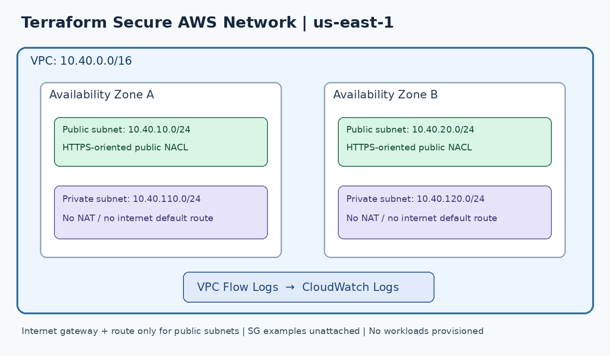
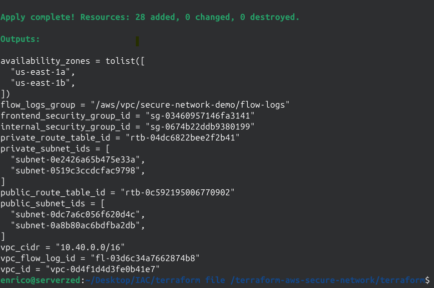

# Secure AWS Network Infrastructure with Terraform

**AWS Cloud Security | Infrastructure as Code | Network Segmentation | VPC Flow Logs**

A hands-on AWS cloud security portfolio lab that uses Terraform to define a segmented Virtual Private Cloud (VPC), implement example network access controls, and configure VPC Flow Logs for network visibility.

> **Project scope:** This is a personal AWS sandbox portfolio lab, **not a production deployment**. Screenshots taken on **October 18, 2026** document a successful Terraform deployment and AWS Console resource status at that time. They do not establish real-workload connectivity, complete security validation, or ongoing availability of temporary sandbox resources.

## Project objectives

- Design a VPC with separate public and private network tiers across two Availability Zones.
- Limit internet routing to public subnets; keep private subnets without a default internet route.
- Define example HTTPS-only security group rules and a subnet-level Network ACL (NACL).
- Configure VPC Flow Logs to send network flow metadata to Amazon CloudWatch Logs.
- Manage the environment declaratively with Terraform and document validation and cleanup steps.

## Architecture



| Component | Configuration |
| --- | --- |
| AWS Region | `us-east-1` (configurable) |
| VPC | `10.40.0.0/16` |
| Public subnet A | `10.40.10.0/24` |
| Public subnet B | `10.40.20.0/24` |
| Private subnet A | `10.40.110.0/24` |
| Private subnet B | `10.40.120.0/24` |
| Availability Zones | First two available AZs returned by AWS |
| Public routing | Internet Gateway with `0.0.0.0/0` in the public route table |
| Private routing | VPC-local route only; no NAT Gateway or internet default route |
| Logging | VPC Flow Logs (`ALL`) to CloudWatch Logs; 7-day retention by default |

**Note:** Public subnet auto-assignment of public IPv4 addresses is disabled. An Internet Gateway route does not, by itself, make a workload publicly accessible.

## Security controls implemented in the code

### Network segmentation

- Two public and two private subnets, with explicit route-table associations.
- An Internet Gateway and internet default route for public subnets only.
- No NAT Gateway and no default internet route for private subnets.

### Security groups

- **Example frontend security group:** allows inbound TCP `443` from the internet; outbound TCP `443` is limited to the VPC CIDR.
- **Example internal application security group:** allows inbound TCP `443` only from resources assigned the frontend security group; no outbound rules are defined.
- No inbound SSH (`22`) or RDP (`3389`) access is configured.

These security groups are **not attached to running workloads**; they demonstrate access-policy design.

### Network ACLs

A custom, stateless NACL is associated with **both public subnets**. Its rules allow inbound HTTPS and ephemeral TCP ports, and outbound TCP traffic. The private subnets use the VPC's default NACL.

The example custom NACL is TCP-focused and is **not a complete production firewall policy**. Real workloads may require additional protocol and return-path rules.

### Network monitoring

- VPC Flow Logs capture accepted and rejected flow metadata (`ALL`) and deliver to CloudWatch Logs.
- Terraform creates the CloudWatch Logs log group and IAM role/policy for log delivery.
- Flow Logs are not packet capture and do not show application payloads. Without network interfaces producing traffic, there may be no log events to inspect.

## Deployment evidence — AWS sandbox (October 18, 2026)

Terraform completed with **28 resources added, 0 changed, and 0 destroyed**, as shown in the terminal capture below. The AWS Console screenshots also show the network resources present and available at capture time.



**Observed results from the screenshots:**

| Evidence | Observed result | Screenshot |
| --- | --- | --- |
| Terraform execution | Successful `terraform apply`; execution plan shown during run; 28 resources added | [Plan output](evidence/07-terraform-applyA.png) · [Apply result](evidence/07-terraform-applyB.png) |
| VPC | `secure-network-demo-vpc`, CIDR `10.40.0.0/16`, state **Available** | [VPC details](evidence/01-vpc.png) |
| Subnets | 2 public subnets (`10.40.10.0/24`, `10.40.20.0/24`) and 2 private subnets (`10.40.110.0/24`, `10.40.120.0/24`), all marked **Available** | [Subnets](evidence/02-subnets.png) |
| Route tables | Dedicated public and private route tables, each showing associations with 2 subnets | [Route tables](evidence/03-route-tables.png) |
| Security groups | Frontend HTTPS and private-application security groups created | [Security groups](evidence/04-security-groups.png) |
| Network ACL | Custom NACL associated with 2 subnets | [Network ACLs](evidence/05-network-acl.png) |
| Network visibility | VPC Flow Log shows **Active**, `ALL` traffic type, and a CloudWatch Logs destination | [VPC Flow Logs](evidence/06-vpc-flow-logs.png) |

Screenshots support the existence and reported status of these resources. **They do not independently prove** the exact effective route entries, individual security-group/NACL rules, CloudWatch log event delivery, or application connectivity. For validation steps and remaining checks, see [docs/validation.md](docs/validation.md).

*The screenshots were supplied from the author's lab session. Some AWS account-identifying text has been obscured in copies intended for public sharing; the original local captures were not changed. Resource IDs may still be visible.*

## Technologies

`AWS VPC` · `AWS IAM` · `Amazon CloudWatch Logs` · `VPC Flow Logs` · `Security Groups` · `Network ACLs` · `Terraform`

## Repository structure

```text
terraform-aws-secure-network/
├── README.md
├── .gitignore
├── architecture/
│   └── network-diagram.png
├── evidence/
│   ├── 01-vpc.png
│   ├── 02-subnets.png
│   ├── 03-route-tables.png
│   ├── 04-security-groups.png
│   ├── 05-network-acl.png
│   ├── 06-vpc-flow-logs.png
│   ├── 07-terraform-applyA.png
│   └── 07-terraform-applyB.png
├── docs/
│   ├── security-decisions.md
│   ├── troubleshooting.md
│   └── validation.md
└── terraform/
    ├── flow_logs.tf
    ├── network.tf
    ├── outputs.tf
    ├── providers.tf
    ├── security.tf
    ├── terraform.tfvars.example
    ├── variables.tf
    └── versions.tf
```

## How to deploy in an authorized AWS sandbox

**Prerequisites:** Terraform `>= 1.5`, AWS CLI with authorized sandbox credentials, a region with at least two Availability Zones, and sufficient permissions for VPC, IAM, CloudWatch Logs, and flow logs.

From the repository root:

```bash
cd terraform
aws sts get-caller-identity
terraform init
terraform fmt -check
terraform validate
terraform plan -out=tfplan
terraform apply tfplan
terraform output
```

To customize variables, copy `terraform/terraform.tfvars.example` to `terraform/terraform.tfvars` **before running** `terraform plan`:

- Windows PowerShell: `Copy-Item terraform.tfvars.example terraform.tfvars`
- macOS/Linux: `cp terraform.tfvars.example terraform.tfvars`

Review the Terraform plan before applying. AWS resources and CloudWatch logging can incur charges. Sandbox restrictions may prevent some resources from being created.

## How to validate

Follow the detailed [validation checklist](docs/validation.md). Key checks include:

1. Confirm the VPC and four subnet CIDR blocks, spread across two AZs.
2. Confirm the public route table has an Internet Gateway default route and the private route table does not.
3. Confirm the public NACL is attached to both public subnets.
4. Confirm security group rules allow the intended HTTPS paths and do not expose SSH.
5. Confirm the VPC Flow Logs destination, traffic type, and CloudWatch retention settings.
6. Record the observed results of `terraform plan` after deployment.

**Evidence status:** Console and terminal evidence from the sandbox deployment is included in `evidence/`. The screenshots establish resource creation/status, not end-to-end validation of all network controls. The linked checklist distinguishes design intent from tests that still require confirmation.

## Cleanup

From the **same Terraform working directory and state** used to create the resources:

```bash
terraform destroy
```

Confirm cleanup in the AWS Console. Even if an AWS training sandbox expires automatically, do not assume local state files or downloaded credentials are safe to publish.

## Design decisions and known limitations

This is a focused network security foundation, not a deployed application. It intentionally has **no EC2 instances, load balancer, application, NAT Gateway, CloudTrail trail, GuardDuty deployment, or CloudWatch alarms**. The sample security groups are unattached; therefore, this repository alone does not demonstrate end-to-end application connectivity or a live security incident investigation.

See [security decisions](docs/security-decisions.md) for trade-offs and [troubleshooting scenarios](docs/troubleshooting.md) for investigation exercises.

## Skills demonstrated by the project and deployment evidence

- Terraform infrastructure definition, AWS resource dependencies, and a successful sandbox apply.
- VPC architecture, CIDR planning, public/private routing, and subnet isolation.
- Stateful security groups versus stateless NACLs.
- Centralized network flow metadata collection using CloudWatch Logs.
- Security documentation, validation planning, and infrastructure teardown.

**Portfolio context:** This is independent hands-on learning work, not claimed as employer production experience. This sandbox environment is temporary and may have been deprovisioned after screenshots were taken. This sandbox environment is temporary and may have been deprovisioned after screenshots were taken. This sandbox environment is temporary and may have been deprovisioned after screenshots were taken.
